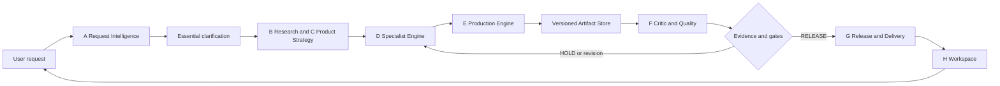

# Master Architecture — AI Factory Rebuild

> خلاصه فارسی: معماری هدف، مرز دامنهها، قراردادهای وضعیت و Artifact، مدل متخصصان، امنیت، کیفیت و بازیابی را تعریف میکند. بازسازی هنوز شروع نشده است.

## 1. Purpose and scope
This document is the canonical target architecture for the audited rebuild. It does not describe the current system as fully implemented; all current defects and limitations are recorded in `CURRENT-STATE.md` and `DECISIONS.md`.

## 2. Target principles
- Understand intent before planning; ask only essential questions.
- Separate product domain, delivery platform, risk, complexity and user constraints.
- Define product goals, users, scope and acceptance criteria before production.
- Activate specialists dynamically from one canonical catalog.
- Producers never approve their own high-impact work as sole authority.
- Artifacts are versioned, hashed and traceable.
- Execution success is not product acceptance.
- Generated files are not proof of quality.
- Quality gates are product-specific and fail closed.
- Low-risk reversible work may proceed with controlled autonomy; sensitive, expensive or irreversible work requires explicit approval.
- Local-first capability detection is truthful; no assumed providers or engines.

## 3. Domain boundaries
| Domain | Owns | Does NOT own |
|---|---|---|
| A Request Intelligence | request record, intent, requirements, clarification, risk/domain/platform/complexity, plan | specialist execution |
| B Research & Innovation | sources, alternatives, feasibility, opportunity records | final product decision |
| C Product Strategy | brief, users, scope, metrics, product acceptance | implementation |
| D Specialist Engine | canonical catalog, activation, dependencies, permissions, execution tracking, verified handoff | domain content quality |
| E Production Engine | real design/code/media/build tools, artifacts, provenance | final quality verdict |
| F Critic & Quality | independent critique, domain evaluators, evidence, gate decisions | releasing product |
| G Release & Delivery | build, signing, manifest, channels, rollback, cost governance | changing quality verdict |
| H Workspace | visibility, review, approvals, blockers, onboarding | decision authority |

## 4. Data flow

## 5. State and artifact contracts
Every persisted record has: stable ID, project ID, schema version, status, timestamps, revision counter and history. Artifacts have: path, SHA-256, version, producer role, required sections, evidence references, acceptance status and limitations. Handoffs must verify current file hash; truncated text is context only, never proof.

## 6. Specialist model
One catalog contains stable ID, purpose, activation criteria, inputs, artifacts, allowed tools, enforceable scopes, dependencies, acceptance criteria, failure/retry behavior and evidence requirements. Roles may be full agents, subroles or capabilities; not every role runs for every task. Independent Critic is always separate from the producer for high-impact acceptance.

## 7. Permission model
Caller-declared scopes are insufficient. SecurityPolicy remains final authority with path containment, command allowlists and explicit confirmation for sensitive actions. Paid, destructive and irreversible operations require user approval bound to a request hash and one-shot token.

## 8. Failure, recovery and idempotency
All state transitions use durable revisions and replay tokens. Duplicate call IDs must not re-execute. Crash recovery must detect stale RUNNING stages and resume or fail closed. Cancellation is cooperative but must be observable; workers that ignore cancellation are reported, not assumed stopped.

## 9. Quality and release model
`execution.ok` means a tool adapter returned. Product acceptance requires evidence from the relevant domain evaluator. Severity-first decisions cannot be hidden by scores. HOLD and BLOCK RELEASE never become RELEASE without explicit recorded user decision. Release manifests bind artifact hash, version, quality decision and approval.

## 10. Security principles
No secrets in source/config; environment only. No runtime data, private projects, sessions or logs in public repos. Capability detection is truthful. External providers have verified records: endpoint, auth, cost, quality, fallback and limits. No fake assets, tests or PASS statuses.

## 11. Key decisions
See `DECISIONS.md`. Unresolved items are marked and must not be silently decided during a phase.

## 12. Audit grounding
This architecture incorporates the verified audit findings, including P0 `oc_state` recursion, registry drift, stale PASS handling, placeholder assets, parallel quality systems and release decision mismatch. It does not claim those are fixed.
