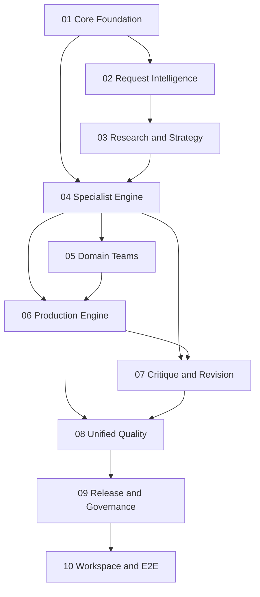

# Rebuild Roadmap

> خلاصه فارسی: دقیقاً ده فاز وابسته بههم تعریف شده است. بازسازی NOT STARTED است و فاز ۰۱ منتظر تأیید صریح کاربر میماند.

Exactly ten phases; no eleventh implementation phase.

| Phase | Dependencies | Exit criteria (summary) | Major risk |
|---|---|---|---|
| 01 Core Foundation | none | recursion fixed, idempotency/recovery proven, tests green | state migration |
| 02 Request Intelligence | 01 | structured request + clarification + approval policy | over-asking |
| 03 Research and Strategy | 02 | evidence-backed brief and measurable criteria | unverifiable sources |
| 04 Specialist Engine | 01,03 | one catalog, verified handoffs, no stale PASS | registry drift |
| 05 Domain Teams | 04 | activation matrix, no unnecessary roles | role duplication |
| 06 Production Engine | 04,05 | real assets/builds, no placeholders | provider capability |
| 07 Critique and Revision | 04,06 | independent critic, decision ledger | infinite revision |
| 08 Unified Quality | 06,07 | one fail-closed quality framework | report-gate mismatch |
| 09 Release and Governance | 08 | signed manifest, honest release decision | billing/signing |
| 10 Workspace and E2E | 09 | mobile UX + full product proof | incomplete onboarding |

Detailed execution missions are in `prompts/PHASE-01.md` through `prompts/PHASE-10.md`.
